# Manual de usuario RiesgoTI — Administrador

Oct 22, 2026

## 1. Introducción e inicio de sesión

Como Administrador, configuras y mantienes RiesgoTI: la IA y sus documentos de referencia, la matriz de evaluación, el catálogo de activos, los usuarios, los roles y la auditoría. También puedes consultar incidencias y riesgos, pero solo en modo lectura.

Por segregación de funciones (ISO/IEC 27001), el Administrador **no** atiende incidencias ni revisa, evalúa, valida, corrige o rechaza riesgos. Esas acciones son exclusivas del rol Analista, y el sistema las bloquea aunque se intenten por otra vía.

### Pantalla: Iniciar sesión

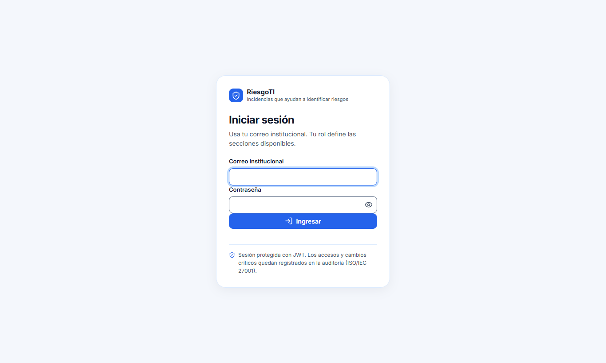

| Elemento | Qué hace |
| --- | --- |
| Campo **Correo institucional** | Escribe tu correo de la empresa. |
| Campo **Contraseña** | Escribe tu contraseña. |
| Icono del ojo (**Mostrar / Ocultar contraseña**) | Muestra u oculta los caracteres de la contraseña. |
| Botón **Ingresar** | Valida tus datos y abre el portal de administración. |

Si las credenciales no son válidas o el usuario está desactivado, aparece un mensaje de error. Tras muchos intentos fallidos seguidos, el acceso se bloquea un minuto. Si otro Administrador olvida su contraseña, puedes asignarle una nueva desde **Usuarios** (ver 3.9).

## 2. Navegación general

El portal tiene una cabecera con tu nombre, tu rol y el botón **Salir**, y un menú lateral agrupado por secciones. En celular, el menú se abre con el botón de tres líneas. Solo ves las opciones para las que tu rol tiene permiso.

| Grupo | Opción del menú | Para qué sirve |
| --- | --- | --- |
| General | **Resumen** | Panel de indicadores y estado del sistema (ver 3.1). |
| Consulta | **Incidencias** | Historial de incidencias, solo lectura (ver 3.2). |
| Consulta | **Registro de riesgos** | Riesgos y sus versiones, solo lectura (ver 3.3). |
| Consulta | **Propuestas de riesgo** | Propuestas de la IA, solo lectura (ver 3.4). |
| Gobierno de riesgos | **Activos** | Catálogo de activos de información (ver 3.5). |
| Gobierno de riesgos | **Matriz de evaluación** | Niveles y criterios de la matriz 5×5 (ver 3.6). |
| Inteligencia artificial | **Documentos** | PDFs normativos que usa la IA (ver 3.7). |
| Inteligencia artificial | **Configuración IA/RAG** | Proveedores, credenciales y parámetros de la IA (ver 3.8). |
| Accesos | **Usuarios** | Alta, edición y activación de usuarios (ver 3.9). |
| Accesos | **Roles y permisos** | Permisos de cada rol (ver 3.10). |
| Accesos | **Auditoría** | Bitácora de acciones críticas (ver 3.11). |
| Cuenta | **Mi cuenta** | Tus datos, tu rol y tus permisos. Es de solo consulta. |

El enlace con flecha **←** arriba del título de un detalle te devuelve a su listado. Las marcas de cita **\[n\]** y los botones **Consultar fuente** abren el panel de cita normativa a la derecha; se cierra con la **X** o con **Esc**.

## 3. Pantallas del Administrador

### 3.1 Panel de administración (Resumen)

Muestra los indicadores de la plataforma y la fecha en que se generaron los datos.

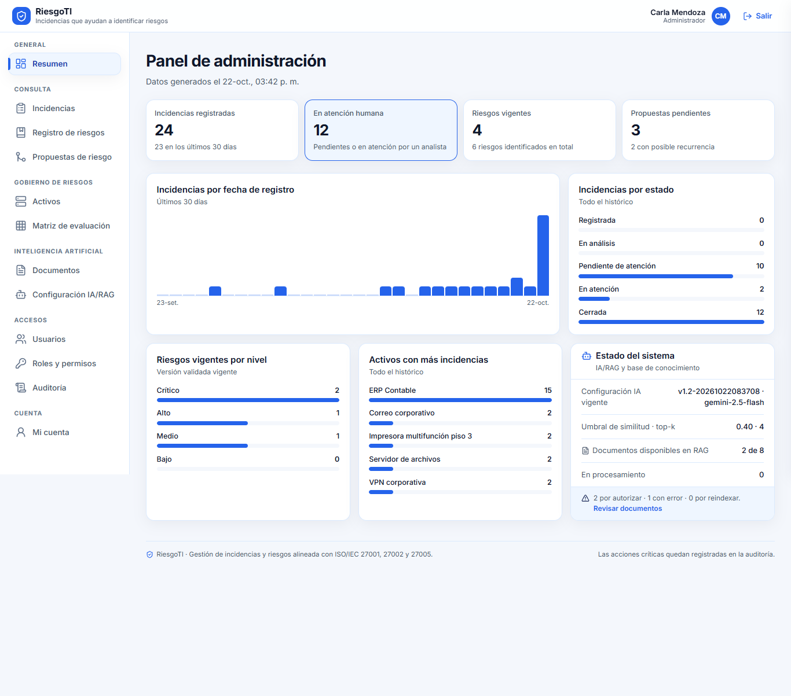

| Elemento | Qué hace |
| --- | --- |
| Indicadores | Incidencias registradas (y cuántas en los últimos 30 días), casos en atención humana, riesgos vigentes y propuestas pendientes. |
| Gráficos | Incidencias por fecha (últimos 30 días), incidencias por estado, riesgos vigentes por nivel y los 5 activos con más incidencias. |
| Tarjeta **Estado del sistema** | Configuración de IA vigente, umbral de similitud y top-k, documentos disponibles para la IA y documentos en procesamiento. |
| Enlace **Revisar documentos** | Aparece si hay documentos por autorizar, con error o por reindexar. Abre la pantalla Documentos. |

### 3.2 Incidencias (consulta)

Historial de todas las incidencias, las más recientes primero.

| Elemento | Qué hace |
| --- | --- |
| Campo **Buscar** y selectores **Estado**, **Activo** y **Antigüedad** | Filtran la tabla. |
| Botón **Limpiar** | Quita todos los filtros. |
| Columna **Sugerencia IA previa** | Indica qué pasó con la orientación de la IA (solucionó, no solucionó, sin respaldo documental, escalada por seguridad, fallo del servicio, en curso). |
| Botón **Ver** | Abre el detalle: reporte original, evidencias (con botón **Descargar**), historial de estados, orientación previa y estado del análisis de riesgo. |

En el detalle no aparece el formulario de atención, porque tu rol no puede atender casos. La columna Sugerencia IA previa te ayuda a detectar problemas: muchos casos «Sin respaldo documental» indican que faltan manuales; muchos «Falló el servicio de IA» indican un problema con el proveedor de IA.

### 3.3 Registro de riesgos (consulta)

Indicadores de riesgos y una tabla con una fila por riesgo y su versión validada vigente.

| Elemento | Qué hace |
| --- | --- |
| Pestañas **Riesgos validados / Propuestas pendientes / Rechazados** | Cambian la categoría de la tabla. |
| Referencia del riesgo (por ejemplo, **RSG-0002**) | Abre el detalle del riesgo con su contenido, incidencias, fuentes y versiones. |
| Botón **Comparar con versión anterior** (en el historial) | Muestra lado a lado qué cambió entre dos versiones. |
| Botón **Consultar fuente** | Abre el fragmento del documento citado. |

### 3.4 Propuestas de riesgo (consulta)

Ves las mismas pestañas que el Analista (**Nuevas agrupaciones**, **Pendientes de revisión**, **Rechazadas**) con un aviso de **Modo lectura**. Al abrir una propuesta puedes leer su contenido, sus incidencias, su evaluación y sus fuentes. Los botones de retirar incidencias, confirmar la agrupación, evaluar, validar, corregir y rechazar no aparecen o están desactivados.

### 3.5 Activos

Catálogo de activos de información que los Reportantes eligen al registrar una incidencia y que los Analistas confirman en los riesgos.

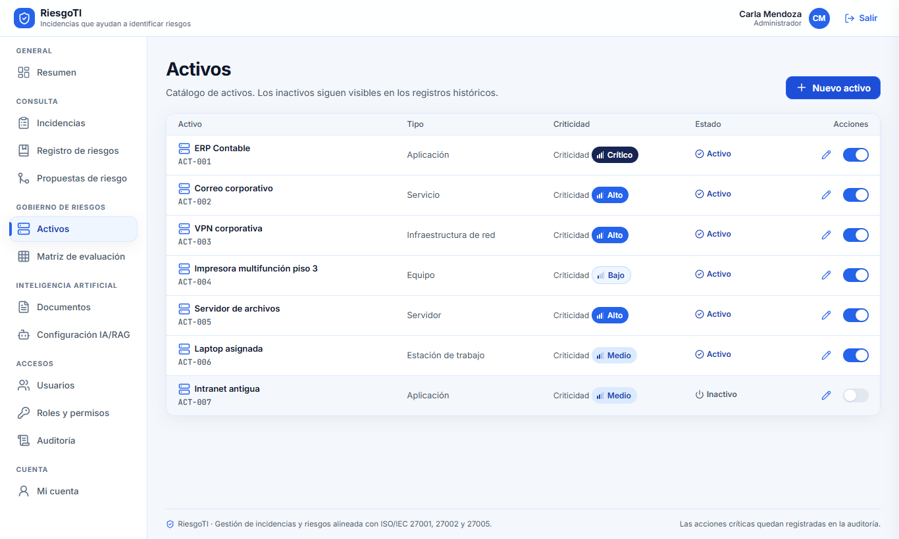

| Elemento | Qué hace |
| --- | --- |
| Botón **Nuevo activo** | Abre el formulario para registrar un activo. |
| Botón del lápiz (**Editar**) | Abre el formulario con los datos del activo. |
| Interruptor de estado | Activa o desactiva el activo. Un activo inactivo deja de ofrecerse en nuevos reportes, pero sigue visible en los registros históricos. No se puede eliminar. |

Campos del formulario **Nuevo activo / Editar activo**:

| Campo | Regla |
| --- | --- |
| **Código** | Obligatorio. Se guarda en mayúsculas. |
| **Tipo** | Obligatorio. Elige uno de la lista. |
| **Nombre** | Obligatorio. Es el nombre que verán los Reportantes. |
| **Criticidad** | Opcional: Bajo, Medio, Alto, Crítico o Sin criticidad. Solo la ven los perfiles autorizados. |
| **Descripción** | Opcional. |

**Cancelar** cierra sin guardar y **Guardar** registra los cambios.

### 3.6 Matriz de evaluación

Define qué nivel de riesgo (Bajo, Medio, Alto o Crítico) corresponde a cada combinación de probabilidad e impacto. El encabezado indica la configuración vigente, quién la publicó y cuándo.

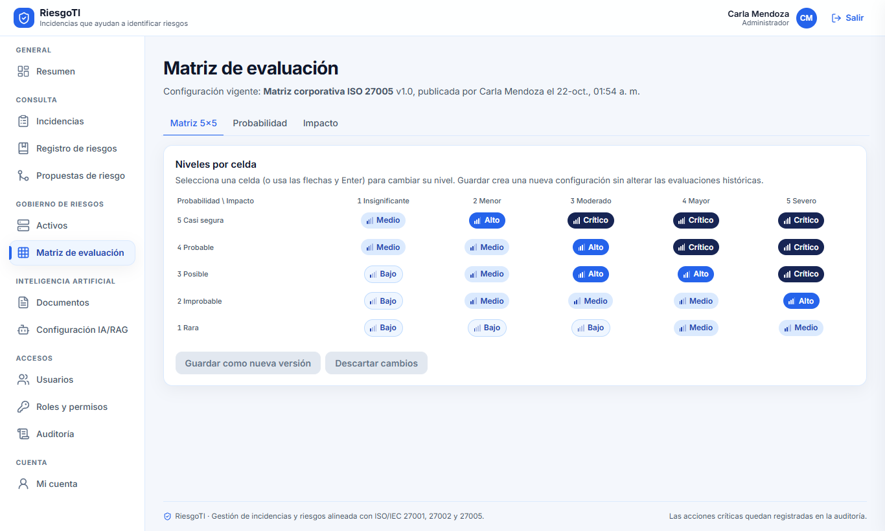

| Elemento | Qué hace |
| --- | --- |
| Pestaña **Matriz 5×5** | Muestra y permite editar los niveles por celda. |
| Pestañas **Probabilidad** e **Impacto** | Muestran el nombre y la descripción de cada criterio del 1 al 5 (solo lectura). |
| Celda de la matriz | Cada clic cambia el nivel de esa celda al siguiente. Con el teclado, muévete con las flechas, Inicio y Fin, y pulsa Enter. Las celdas modificadas quedan con borde punteado. |
| Contador **n celdas modificadas** | Indica cuántos cambios hay sin publicar. |
| Botón **Descartar cambios** | Vuelve a la matriz vigente sin guardar. |
| Botón **Guardar como nueva versión** | Abre la ventana de publicación. |
| Campo **Nombre de la configuración** (en la ventana) | Nombre de la nueva versión. Mínimo 3 caracteres. |
| Botón **Publicar versión** / **Cancelar** | Publica la nueva matriz o cierra la ventana sin publicar. |

Publicar una matriz no cambia las evaluaciones ya registradas: conservan la celda y la matriz con las que se hicieron. Las evaluaciones nuevas usan la matriz publicada.

### 3.7 Documentos

Administra los PDFs normativos (políticas, procedimientos, manuales) en los que se basa la IA. Solo las versiones **procesadas, autorizadas y activas** se usan en nuevas consultas.

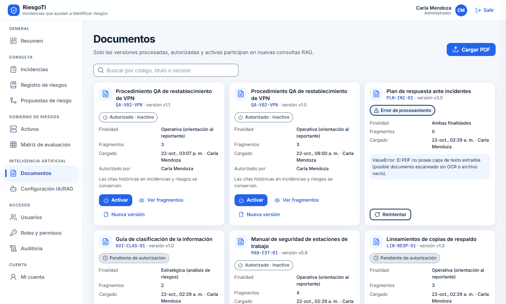

| Elemento | Qué hace |
| --- | --- |
| Botón **Cargar PDF** | Abre el formulario para subir un documento nuevo. |
| Buscador | Filtra por código, título o versión. |
| Aviso **Actualizando el estado cada 3 segundos** | Aparece mientras hay PDFs en procesamiento; la pantalla se refresca sola. |
| Botón **Reintentar** | Aparece si el procesamiento falló. Vuelve a procesar el PDF; el error se muestra en la tarjeta. |
| Botón **Previsualizar y autorizar** | Aparece en versiones **Pendiente de autorización**. Abre la vista de fragmentos. |
| Botón **Desactivar** | Saca de las consultas de la IA una versión disponible. Las citas históricas se conservan. |
| Botón **Activar** | Vuelve a incluir en las consultas una versión autorizada inactiva. |
| Botón **Reindexar** | Aparece si la versión se indexó con un modelo de embeddings distinto al vigente. La vuelve a indexar con el modelo actual. |
| Botón **Ver fragmentos** | Muestra cómo quedó dividido el documento. |
| Botón **Nueva versión** | Abre el formulario de carga con el código, título y finalidad del documento ya completados. La versión anterior y sus citas se conservan. |

Estados de cada versión: **Procesando PDF a Markdown**, **Error de procesamiento**, **Pendiente de autorización**, **Disponible en RAG** y **Autorizado · inactivo**.

Formulario **Cargar PDF normativo / Cargar nueva versión**:

| Campo o botón | Regla |
| --- | --- |
| **Código** | Obligatorio, de 2 a 50 caracteres (por ejemplo, POL-SGSI-01). No se puede cambiar en una nueva versión. |
| **Versión** | Obligatoria (por ejemplo, v2.1). |
| **Título** | Obligatorio, mínimo 5 caracteres. |
| **Finalidad** | **Operativa** (orientación al Reportante), **Estratégica** (análisis de riesgos) o **Ambas**. Define qué parte de la IA puede citarlo. |
| **Descripción** | Opcional. |
| Zona **Arrastra un PDF o haz clic para seleccionarlo** | Un solo archivo PDF de hasta 25 MB. La **X** lo quita. |
| Botón **Cargar PDF** / **Cancelar** | Sube el documento y empieza a procesarlo, o cierra sin subir. |

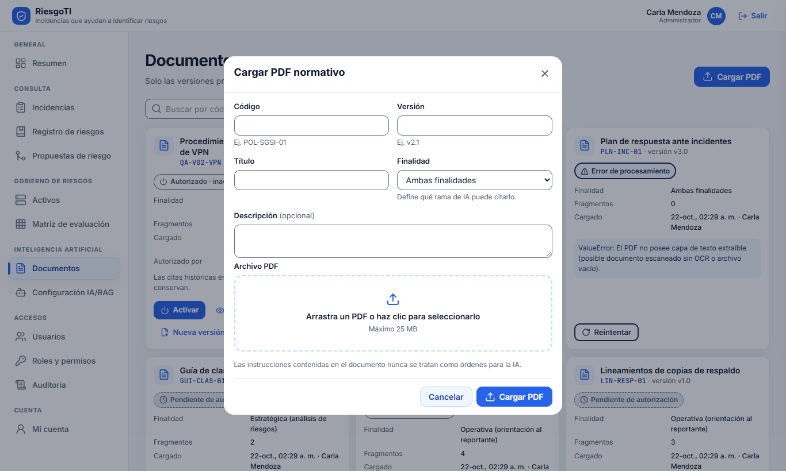

Ventana de previsualización:

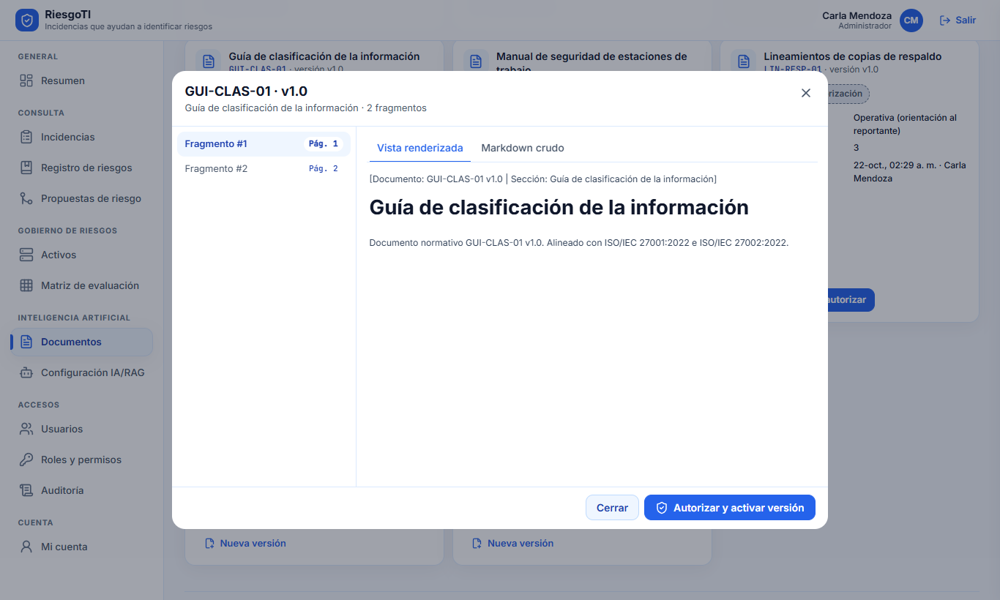

| Elemento | Qué hace |
| --- | --- |
| Lista **Fragmento #n** (a la izquierda) | Elige el fragmento que quieres ver y sus páginas. |
| Pestañas **Vista renderizada / Markdown crudo** | Muestran el fragmento con formato o como texto original. |
| Botón **Autorizar y activar versión** | Aprueba la versión y la pone disponible para la IA. Solo aparece en versiones pendientes. |
| Botón **Cerrar** | Cierra la ventana sin autorizar. |

Revisa que tablas, títulos y páginas se vean correctos antes de autorizar. Las instrucciones escritas dentro de un documento nunca se tratan como órdenes para la IA.

### 3.8 Configuración IA/RAG

Define qué modelos usa la IA y cómo busca en los documentos. Cada cambio publica una versión nueva y queda en la auditoría; el encabezado muestra la versión vigente.

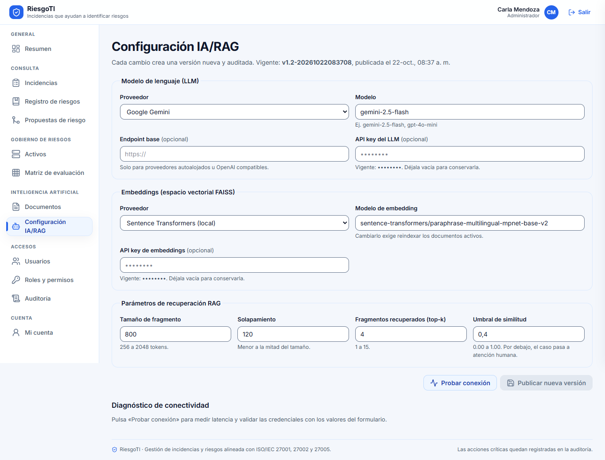

En la captura las API keys aparecen ocultas con puntos, igual que en la pantalla real.

| Campo | Qué define | Regla |
| --- | --- | --- |
| **Proveedor** (LLM) | Servicio que redacta las orientaciones y propuestas: Google Gemini, OpenAI o Hugging Face (local). | Obligatorio. |
| **Modelo** | Nombre del modelo, por ejemplo gemini-2.5-flash o gpt-4o-mini. | Mínimo 2 caracteres. |
| **Endpoint base** | Dirección del servicio, solo para proveedores propios u OpenAI compatibles. | Opcional; debe ser una URL. |
| **API key del LLM** | Clave del proveedor. Se guarda cifrada y nunca se muestra; solo ves una máscara. | Vacía conserva la clave actual. |
| **Proveedor** (Embeddings) | Servicio que convierte el texto en vectores: Sentence Transformers (local), Google Gemini u OpenAI. | Obligatorio. |
| **Modelo de embedding** | Modelo de vectores. | Cambiarlo obliga a reindexar los documentos activos. |
| **API key de embeddings** | Clave del proveedor de embeddings. | No se necesita en modelos locales. Vacía conserva la actual. |
| **Tamaño de fragmento** | Cuánto texto tiene cada fragmento de documento. | De 256 a 2048 tokens. |
| **Solapamiento** | Cuánto texto comparten dos fragmentos seguidos. | De 0 a 512 y menor a la mitad del tamaño. |
| **Fragmentos recuperados (top-k)** | Cuántos fragmentos consulta la IA por pregunta. | De 1 a 15. |
| **Umbral de similitud** | Parecido mínimo entre el reporte y un fragmento para usarlo. Si ninguno lo alcanza, el caso pasa a atención humana. | De 0.00 a 1.00. |

| Botón o aviso | Qué hace |
| --- | --- |
| Botón **Probar conexión** | Prueba los valores del formulario sin guardarlos. Muestra en **Diagnóstico de conectividad** si el modelo de lenguaje y los embeddings respondieron, su latencia en milisegundos y las dimensiones del vector. |
| Botón **Publicar nueva versión** | Guarda la configuración como versión nueva. Se activa solo si cambiaste algo. |
| Aviso **Documentos pendientes de reindexación** | Lista las versiones indexadas con otro modelo. No participan en las búsquedas hasta que uses **Reindexar** en Documentos. |

Un umbral más alto da respuestas más precisas pero deriva más casos a los Analistas; uno más bajo responde más casos con menor precisión. Prueba la conexión antes de publicar.

### 3.9 Usuarios

Cada usuario tiene un solo rol. Los usuarios se desactivan, nunca se eliminan.

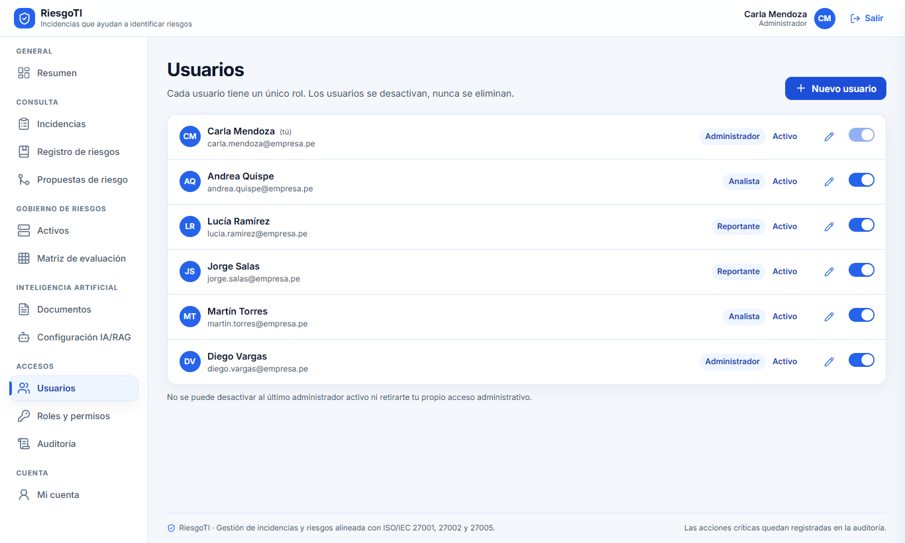

| Elemento | Qué hace |
| --- | --- |
| Botón **Nuevo usuario** | Abre el formulario de alta. |
| Fila de usuario | Muestra nombre, correo, rol y estado. Tu usuario aparece marcado con «(tú)». |
| Botón del lápiz (**Editar**) | Abre el formulario con los datos del usuario. |
| Interruptor de estado | Activa o desactiva el usuario. Un usuario inactivo no puede iniciar sesión. |

No se puede desactivar al último Administrador activo ni quitarte tu propio acceso de administración; en esos casos el interruptor aparece bloqueado y explica el motivo.

Formulario **Nuevo usuario / Editar usuario**:

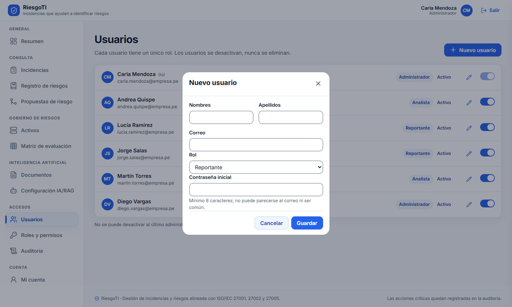

| Campo | Regla |
| --- | --- |
| **Nombres** y **Apellidos** | Obligatorios. |
| **Correo** | Obligatorio y único. Es el usuario para iniciar sesión. |
| **Rol** | Obligatorio. Solo se ofrecen roles activos. |
| **Contraseña inicial** (alta) | Mínimo 8 caracteres; no puede parecerse al correo ni ser una contraseña común. |
| **Nueva contraseña** (edición) | Opcional. Vacía conserva la actual; úsala para restablecer una contraseña olvidada. |

**Cancelar** cierra sin guardar y **Guardar** registra los cambios.

### 3.10 Roles y permisos

A la izquierda están los roles (del sistema o personalizados) con su cantidad de permisos y usuarios. A la derecha, el editor del rol elegido.

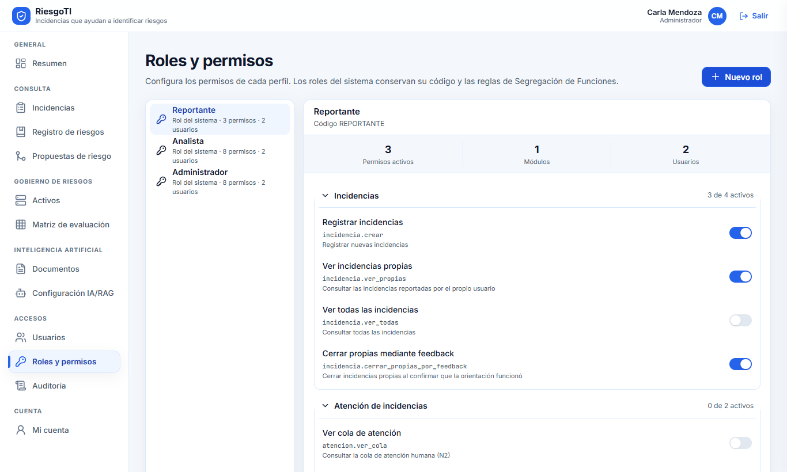

| Elemento | Qué hace |
| --- | --- |
| Botón **Nuevo rol** | Abre el formulario para crear un rol personalizado, que nace sin permisos. |
| Rol de la lista | Lo abre en el editor. |
| Encabezado de módulo (Incidencias, Atención de incidencias, Riesgos, Administración) | Despliega o pliega sus permisos y muestra cuántos están activos. |
| Interruptor de cada permiso | Lo agrega o lo quita del borrador. |
| Candado con motivo | El permiso no se puede cambiar por segregación de funciones o porque el rol ADMIN debe conservarlo. |
| Botón **Descartar** | Deshace los cambios del borrador. |
| Botón **Revisar y guardar** | Abre el **Resumen de cambios** con los permisos que se agregan y se retiran. |
| Botón **Guardar permisos** / **Cancelar** (en el resumen) | Aplica o anula los cambios. Aplican en el próximo inicio de sesión de los usuarios con ese rol. |

Reglas de segregación: el rol ADMIN nunca puede recibir los permisos de revisar agrupaciones, evaluar o validar riesgos, y ningún rol puede combinar permisos de administración con permisos de evaluación de riesgos.

Formulario **Nuevo rol**: **Nombre del rol** (por ejemplo, Auditor de seguridad) y **Código** (mayúsculas, dígitos y guion bajo, por ejemplo AUDITOR\_TI). **Crear rol** lo guarda y lo abre en el editor.

### 3.11 Auditoría

Bitácora inmutable de inicios de sesión, cambios de configuración y decisiones sobre incidencias y riesgos. Es de solo lectura.

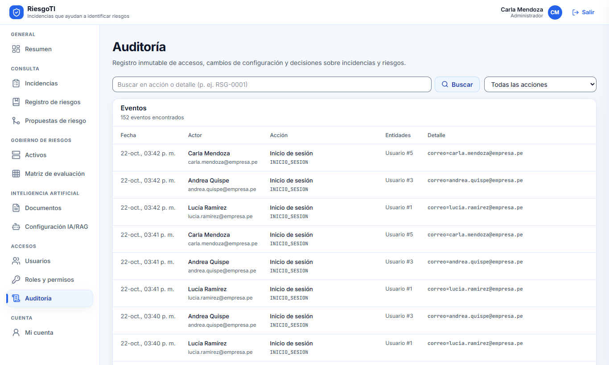

| Elemento | Qué hace |
| --- | --- |
| Campo **Buscar en acción o detalle** y botón **Buscar** | Filtra por texto, por ejemplo RSG-0001. |
| Selector **Todas las acciones** | Muestra solo un tipo de acción. |
| Tabla de eventos | Fecha, actor (o «Sistema»), acción, entidades afectadas y detalle. Arriba indica cuántos eventos se encontraron. |
| Paginador | Pasa entre páginas de eventos. |

## 4. Estados, mensajes y errores frecuentes

Un documento solo participa en las respuestas de la IA cuando está **Disponible en RAG**: procesado, autorizado por ti y activo.

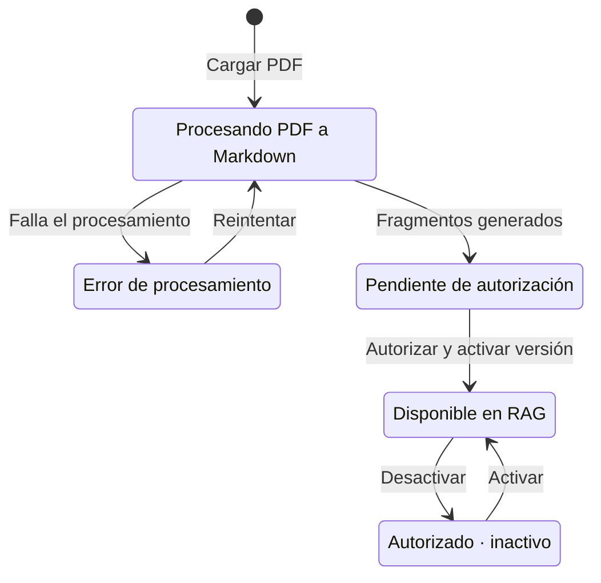

Si cambias el modelo de embeddings, las versiones disponibles quedan marcadas para **Reindexar** y no se usan hasta reindexarlas.

Mensajes frecuentes:

| Mensaje | Pantalla | Qué hacer |
| --- | --- | --- |
| «El solapamiento (chunk\_overlap) debe ser estrictamente menor a la mitad del chunk\_size» | Configuración IA/RAG | Baja el solapamiento o sube el tamaño de fragmento. |
| Tarjeta **Error** en el diagnóstico de conectividad | Configuración IA/RAG | Revisa el modelo, el endpoint y la API key; el mensaje del proveedor aparece en la tarjeta. |
| «La prueba no pudo ejecutarse» | Configuración IA/RAG | El servidor no pudo contactar al proveedor. Reintenta y revisa la red. |
| «El código del documento es obligatorio (ej. POL-SGSI-01)» | Documentos | Completa el código. |
| «El título debe tener al menos 5 caracteres» | Documentos | Amplía el título. |
| «La versión es obligatoria (ej. v1.0)» | Documentos | Indica la versión. |
| Tarjeta **Error de procesamiento** con detalle | Documentos | Revisa que el PDF no esté dañado ni protegido y pulsa **Reintentar**; si persiste, carga un PDF corregido. |
| «Ingresa un nombre de al menos 3 caracteres» | Matriz de evaluación | Escribe un nombre para la nueva configuración. |
| Interruptor bloqueado con motivo | Usuarios | Es el último Administrador activo o tu propio acceso. Crea u otorga otro Administrador primero. |
| Candado «Bloqueado por Segregación de Funciones (ISO 27001)» | Roles y permisos | El permiso no puede combinarse con los que ya tiene el rol. |
| Aviso **Modo lectura** | Propuestas de riesgo | Es normal para tu rol: la revisión de riesgos es del Analista. |

## 5. Preguntas frecuentes y buenas prácticas

**¿Por qué no puedo validar ni evaluar un riesgo?** Por segregación de funciones (ISO/IEC 27001): quien configura el sistema no puede decidir sobre los riesgos. Pídeselo a un Analista.

**Un usuario con un rol personalizado entra y ve «El portal del rol … se está migrando».** Por ahora solo los roles Reportante, Analista y Administrador tienen pantallas propias. Si el usuario necesita trabajar ya, asígnale uno de esos tres roles.

**Cambié los permisos de un rol y el usuario no ve el cambio.** Los permisos se aplican en el próximo inicio de sesión. Pídele que pulse **Salir** y vuelva a entrar.

**¿Desactivar un documento borra las citas de incidencias pasadas?** No. La versión deja de usarse en consultas nuevas, pero las citas históricas se conservan intactas.

**Un Analista resolvió un caso con una buena solución, ¿se añade sola a la IA?** No. Las notas de los Analistas nunca alimentan a la IA automáticamente. Si la solución debe formar parte de un manual, actualiza el documento y cárgalo con **Nueva versión**, luego revísalo y autorízalo.

**¿Cómo retiro una API key?** Dejar el campo vacío conserva la clave anterior. Para cambiarla, escribe la nueva clave y publica una nueva versión. Hoy no hay forma de borrarla sin reemplazarla.

Buenas prácticas:

- Usa siempre **Probar conexión** antes de **Publicar nueva versión** en la configuración de IA.
- Si cambias el modelo de embeddings, reindexa enseguida todos los documentos marcados.
- Revisa varios fragmentos de cada PDF antes de autorizarlo, sobre todo las tablas.
- Elige bien la finalidad del documento: los manuales de soporte son Operativos; las políticas y normas de riesgo, Estratégicas.
- Mantén al día la criticidad de los activos: los Analistas la usan para evaluar riesgos.
- Desactiva los usuarios que dejan la empresa el mismo día.
- Revisa la auditoría con regularidad, en especial los cambios de configuración y de permisos.
