# Manual de usuario RiesgoTI — Analista

Oct 22, 2026

## 1. Introducción e inicio de sesión

Como Analista tienes dos trabajos en RiesgoTI. En la **operación** atiendes los casos que la IA no pudo resolver (atención de segundo nivel, N2). En el **gobierno de riesgos** revisas las propuestas de riesgo que prepara la IA, las evalúas en la matriz 5×5 y decides si se validan, se corrigen o se rechazan (ISO/IEC 27005). Solo el rol Analista puede evaluar y decidir riesgos: el Administrador no tiene ese permiso, por segregación de funciones (ISO/IEC 27001).

### Pantalla: Iniciar sesión

| Elemento | Qué hace |
| --- | --- |
| Campo **Correo institucional** | Escribe tu correo de la empresa. |
| Campo **Contraseña** | Escribe tu contraseña. |
| Icono del ojo (**Mostrar / Ocultar contraseña**) | Muestra u oculta los caracteres de la contraseña. |
| Botón **Ingresar** | Valida tus datos y abre la consola del Analista. |

Si las credenciales no son válidas o tu usuario está desactivado, aparece un mensaje de error. Tras muchos intentos fallidos seguidos, el acceso se bloquea un minuto. Para restablecer la contraseña, contacta a un Administrador.

## 2. Navegación general

La consola tiene una cabecera con tu nombre, tu rol y el botón **Salir**, y un menú lateral agrupado por secciones. En celular, el menú se abre con el botón de tres líneas de la cabecera. Solo ves las opciones para las que tu rol tiene permiso.

| Grupo | Opción del menú | Para qué sirve |
| --- | --- | --- |
| General | **Resumen** | Indicadores de incidencias y riesgos (ver 3.1). |
| Operación | **Incidencias** | Historial de todas las incidencias (ver 3.2). |
| Operación | **Atención de incidencias** | Cola de casos que esperan atención humana (ver 3.2). |
| Gobierno de riesgos | **Propuestas de riesgo** | Bandeja de propuestas preparadas por la IA (ver 3.4). |
| Gobierno de riesgos | **Registro de riesgos** | Riesgos vigentes, pendientes y rechazados (ver 3.6). |
| Consulta | **Activos** | Catálogo de activos, solo lectura (ver 3.8). |
| Consulta | **Matriz de evaluación** | Criterios y niveles de la matriz 5×5, solo lectura (ver 3.8). |
| Cuenta | **Mi cuenta** | Tus datos, tu rol y tus permisos efectivos. Es de solo consulta. |

Cuando abres un caso o una propuesta, el menú sigue resaltando la sección desde la que entraste. El enlace con flecha **←** arriba del título te devuelve a esa bandeja.

En cualquier pantalla con citas, el botón **Consultar fuente** o una marca **\[n\]** abre el **panel de cita normativa** a la derecha. Muestra el documento, sus páginas y el fragmento exacto. Se cierra con la **X** o con la tecla **Esc**.

La pantalla **Mi cuenta** muestra tus datos y los permisos de tu rol:

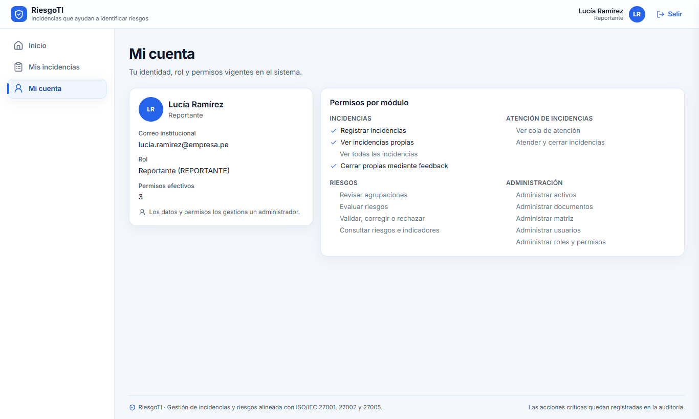

## 3. Pantallas del Analista

### 3.1 Resumen

Da el panorama operativo y estratégico. Los filtros solo afectan a los indicadores de incidencias.

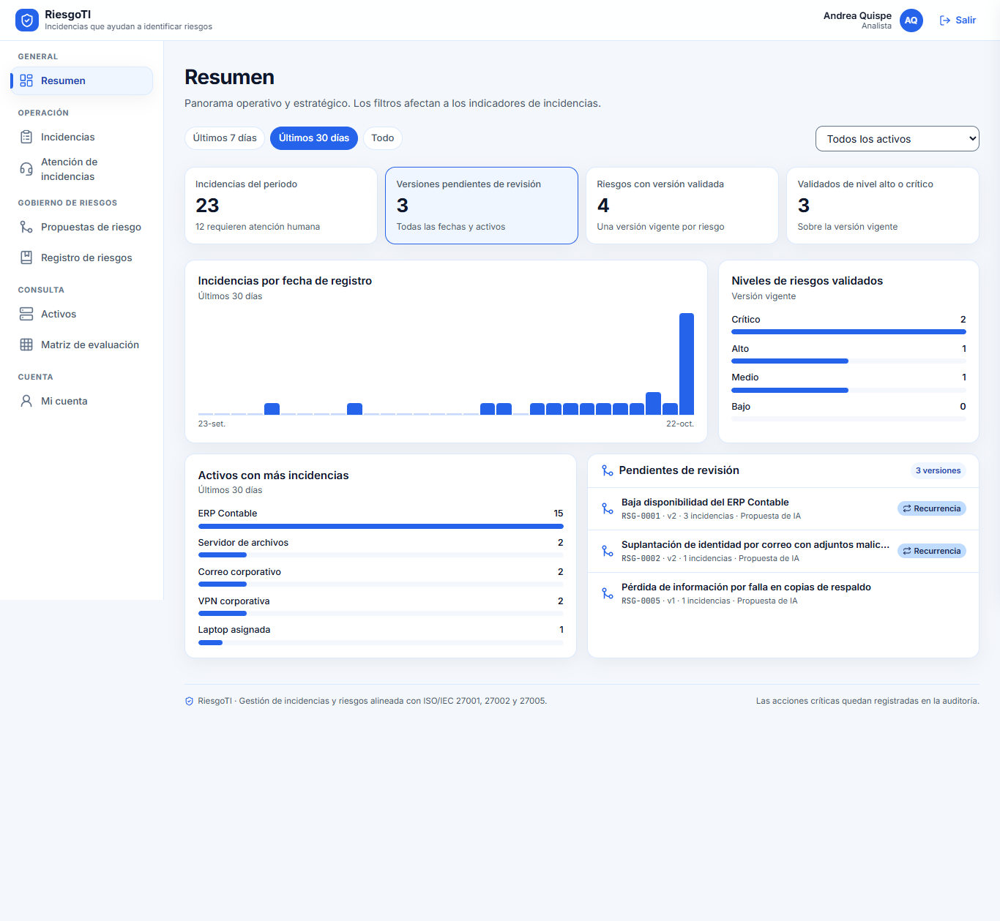

| Elemento | Qué hace |
| --- | --- |
| Filtro **Últimos 7 días / Últimos 30 días / Todo** | Cambia el periodo de los indicadores y gráficos de incidencias. |
| Selector **Todos los activos** | Limita los indicadores de incidencias a un activo. |
| Indicadores | Incidencias del periodo (y cuántas requieren atención humana), versiones pendientes de revisión, riesgos con versión validada y riesgos validados de nivel alto o crítico. |
| Gráfico **Incidencias por fecha de registro** | Muestra cuántas incidencias se registraron cada día del periodo. |
| Gráfico **Niveles de riesgos validados** | Reparte los riesgos vigentes por nivel. |
| Gráfico **Activos con más incidencias** | Ordena los activos por número de incidencias del periodo. |
| Lista **Pendientes de revisión** | Muestra hasta 5 propuestas de riesgo pendientes. Pulsa una para abrir su espacio de trabajo (ver 3.5). La etiqueta **Recurrencia** marca riesgos que podrían repetirse. |

### 3.2 Atención de incidencias e Incidencias

Las dos pantallas usan la misma tabla y los mismos filtros, con 10 filas por página.

- **Atención de incidencias** es la cola N2: solo casos **Pendiente de atención** o **En atención**, los más antiguos primero.
- **Incidencias** es el historial completo de todos los estados, los más recientes primero.

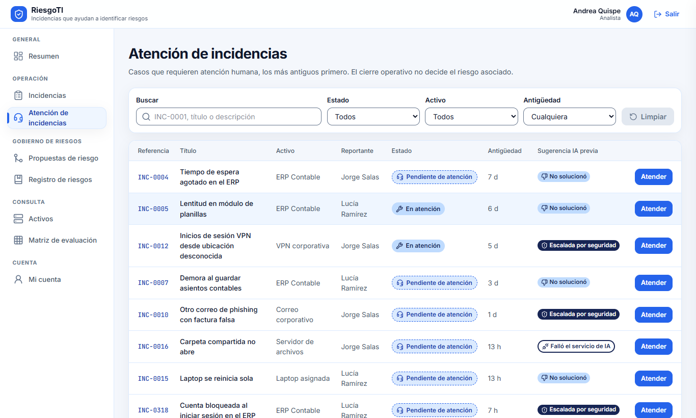

| Elemento | Qué hace |
| --- | --- |
| Campo **Buscar** | Filtra por referencia (INC-0001), título o descripción. |
| Selector **Estado** | Filtra por estado de la incidencia. |
| Selector **Activo** | Filtra por activo afectado. Los activos inactivos aparecen marcados. |
| Selector **Antigüedad** | Muestra casos de menos de 1, 7 o 30 días, o de cualquier fecha. |
| Botón **Limpiar** | Quita todos los filtros. Solo se activa si hay alguno aplicado. |
| Columna **Sugerencia IA previa** | Indica por qué llegó el caso: Escalada por seguridad, Sin respaldo documental, No solucionó, Solucionó, Falló el servicio de IA, Orientación en curso o Sugerida sin respuesta. |
| Botón **Atender** (en la cola) o **Ver** (en el historial) | Abre el caso (ver 3.3). |
| Indicador **Actualizando** | Aparece mientras la lista se refresca sola. |

### 3.3 Detalle del caso (consola N2)

Muestra el título, la referencia, el reportante, la fecha, el motivo del escalamiento y el estado.

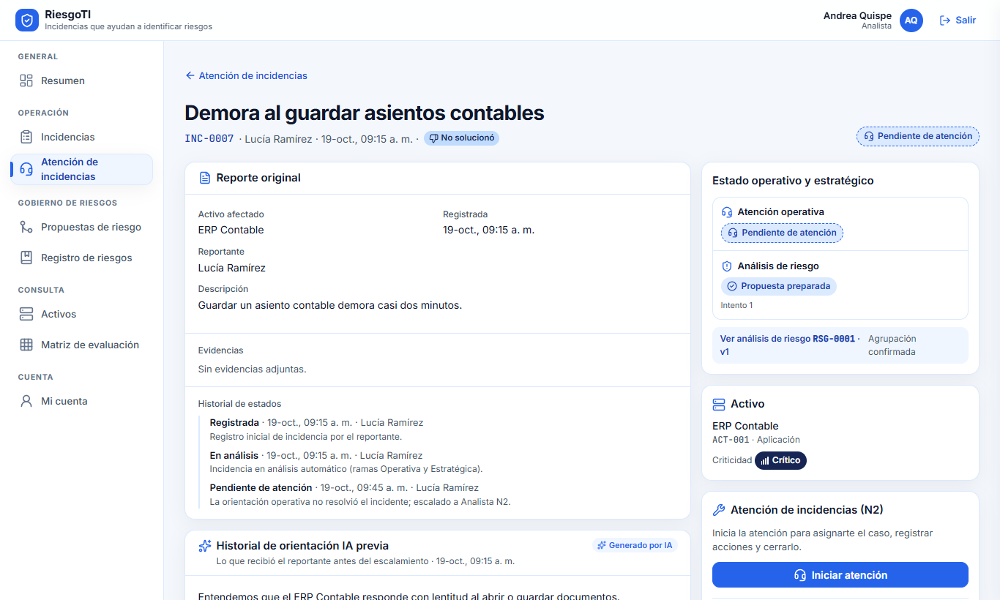

| Elemento | Qué hace |
| --- | --- |
| Tarjeta **Reporte original** | Activo, fecha, reportante, descripción, evidencias e historial de estados. |
| Botón **Descargar** (en cada evidencia) | Descarga el archivo que adjuntó el reportante. |
| Tarjeta **Historial de orientación IA previa** | Muestra los pasos y las citas que recibió el reportante, y si respondió que funcionaron. Si no recibió pasos, explica por qué (sin respaldo documental, fallo de la IA o caso de seguridad). |
| Panel **Estado operativo y estratégico** | Muestra el estado de la atención y del análisis de riesgo, con el número de intento. |
| Botón **Reintentar análisis** | Solo aparece si el análisis de riesgo falló. Vuelve a lanzar el análisis; la incidencia no se modifica. |
| Botón **Ver análisis de riesgo RSG-…** | Abre el espacio de trabajo del riesgo vinculado a esta incidencia (ver 3.5). |
| Tarjeta **Activo** | Nombre, código, tipo y criticidad del activo afectado. |
| Botón **Iniciar atención** | Aparece en casos **Pendiente de atención**. Te asigna el caso y lo pasa a **En atención**. |
| Campo **Acciones realizadas** | Describe qué verificaste o ejecutaste. |
| Campo **Nota de resolución** | Describe cómo quedó resuelto. El reportante la ve al cerrar el caso. |
| Botón **Guardar nota** | Guarda el avance sin cerrar el caso. Puedes guardar las veces que quieras. |
| Botón **Cerrar incidencia** | Cierra el caso. Exige al menos 10 caracteres en cada campo. |

Cuando el caso está asignado a ti, el panel de atención muestra el formulario:

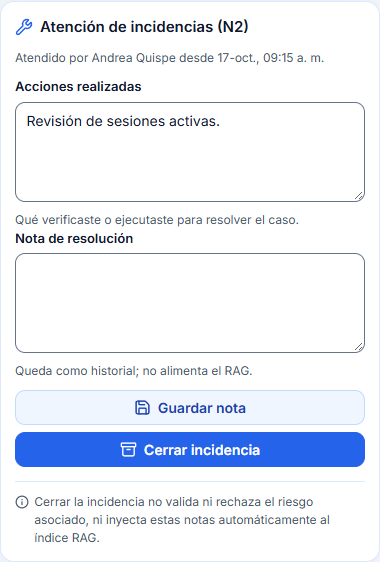

Solo el analista asignado puede registrar la atención. Si otra persona tiene el caso, verás quién lo atiende y desde cuándo. Si el caso sigue **En análisis**, el formulario no aparece porque el reportante aún no pidió ayuda.

Cerrar la incidencia no valida ni rechaza el riesgo asociado. Tus notas tampoco entran automáticamente a la base de conocimiento de la IA: para eso un Administrador debe publicar una nueva versión del manual.

### 3.4 Propuestas de riesgo

Bandeja de propuestas preparadas por la IA a partir de las incidencias. Tú tienes la decisión final.

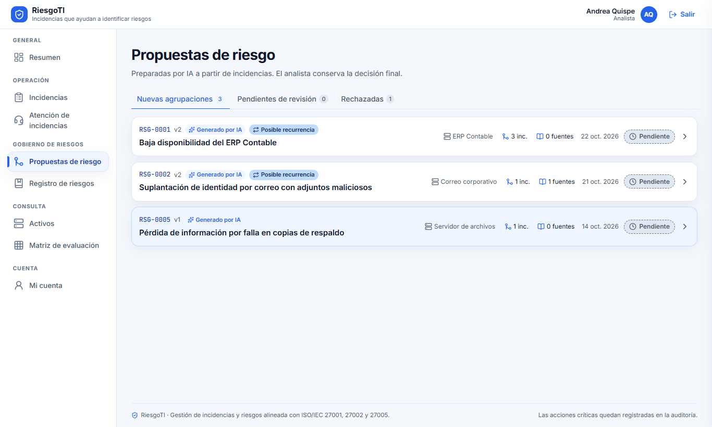

| Elemento | Qué hace |
| --- | --- |
| Pestaña **Nuevas agrupaciones** | Propuestas cuya agrupación de incidencias aún no revisaste. |
| Pestaña **Pendientes de revisión** | Propuestas con agrupación confirmada que esperan tu decisión. |
| Pestaña **Rechazadas** | Versiones rechazadas, conservadas como historial. |
| Tarjeta de propuesta | Muestra el código del riesgo, la versión, si viene de la IA, el activo identificado, las incidencias incluidas, las fuentes, la fecha y el estado. Pulsa el título o cualquier parte de la tarjeta para abrir el espacio de trabajo. |
| Etiqueta **Posible recurrencia** | El riesgo ya tenía una versión validada y la IA propone una nueva. |

### 3.5 Espacio de trabajo de la propuesta

Aquí revisas, evalúas y decides. El trabajo sigue cuatro pasos: depurar la agrupación, confirmar el activo, evaluar en la matriz y registrar la decisión.

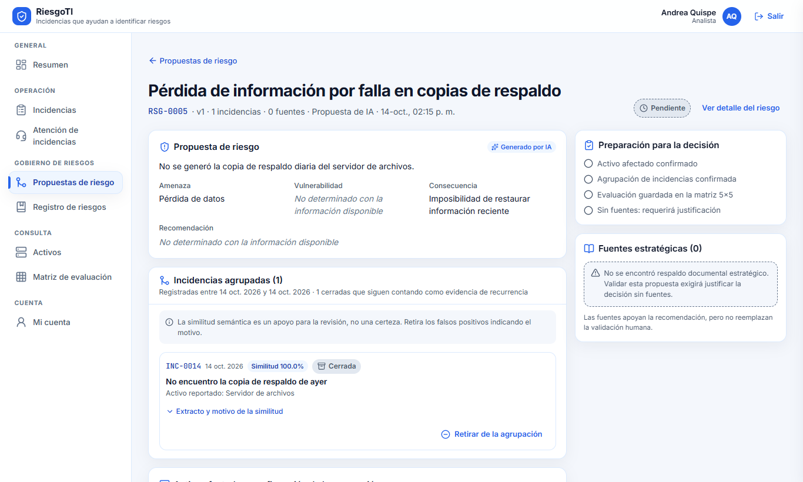

**Cabecera y avisos**

| Elemento | Qué hace |
| --- | --- |
| Botón **Ver detalle del riesgo** | Abre la ficha del riesgo en el registro (ver 3.7). |
| Aviso «Esta versión ya tiene una decisión registrada y es inmutable» | Ya no se puede modificar: solo consultar. |
| Aviso de **posible recurrencia** | La versión vigente se mantiene hasta que decidas esta propuesta. |
| Sección **Propuesta de riesgo** | Descripción, amenaza, vulnerabilidad, consecuencia y recomendación redactadas por la IA. |

**Paso 1: Incidencias agrupadas**

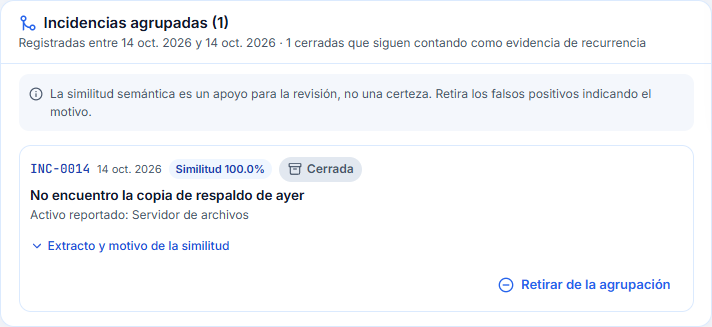

| Elemento | Qué hace |
| --- | --- |
| Tarjeta de cada incidencia | Referencia, fecha, porcentaje de similitud, estado, título y activo reportado. Si la similitud es menor al 65 %, avisa que puede ser un falso positivo. |
| Desplegable **Extracto y motivo de la similitud** | Muestra el fragmento del reporte y por qué la IA lo agrupó. |
| Botón **Retirar de la agrupación** | Abre una ventana para retirar un falso positivo. |
| Campo **Motivo del retiro** (en la ventana) | Explica por qué la incidencia no pertenece al riesgo. Mínimo 10 caracteres. |
| Botón **Retirar incidencia** / **Cancelar** | Confirma o anula el retiro. La incidencia no se borra: pasa a la lista de excluidas. Si la agrupación estaba confirmada, tendrás que confirmarla otra vez. |
| Botón **Excluidas de la agrupación (n)** | Muestra u oculta las incidencias retiradas, con su motivo y quién las retiró. |
| Botón **Restaurar** | Devuelve una incidencia excluida a la agrupación. |

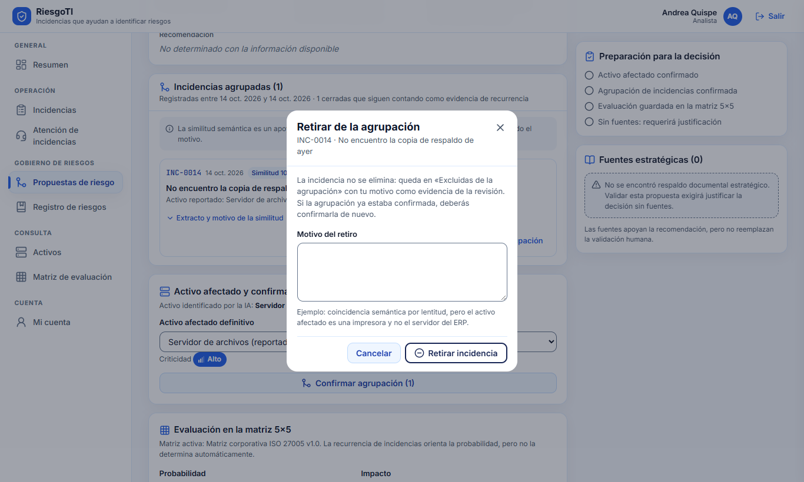

Las incidencias cerradas siguen contando como evidencia de recurrencia del riesgo.

**Paso 2: Activo afectado y confirmación de la agrupación**

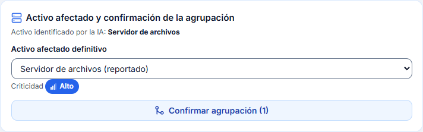

| Elemento | Qué hace |
| --- | --- |
| Selector **Activo afectado definitivo** | Elige el activo del catálogo. Los activos que aparecen en las incidencias se marcan como «(reportado)». Al elegirlo se muestra su criticidad. |
| Campo **Justificación del cambio de activo** | Aparece si eliges un activo distinto al reportado. Mínimo 10 caracteres. |
| Botón **Confirmar agrupación (n)** | Confirma el activo y las n incidencias incluidas. Se desactiva si no queda ninguna incidencia. |
| Botón **Cambiar activo confirmado** | Vuelve a abrir el selector después de confirmar. **Cancelar** descarta el cambio. |

**Paso 3: Evaluación en la matriz 5×5**

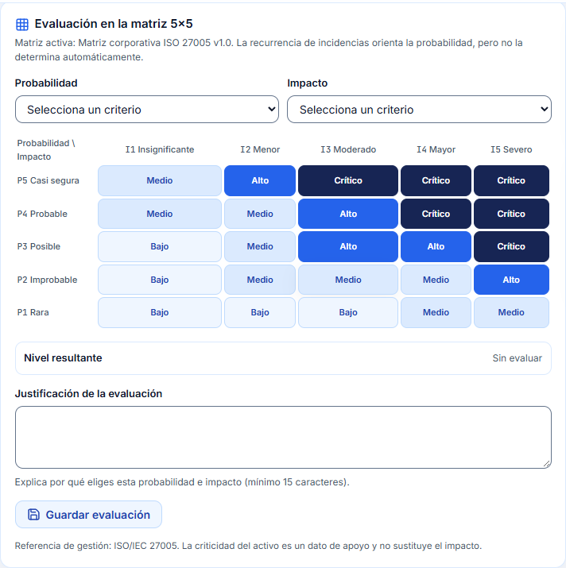

| Elemento | Qué hace |
| --- | --- |
| Selectores **Probabilidad** e **Impacto** | Elige un criterio del 1 al 5 para cada eje. |
| Celdas de la matriz | Pulsa una celda para elegir probabilidad e impacto a la vez. Con el teclado, muévete con las flechas, Inicio y Fin. La celda elegida queda marcada. |
| **Nivel resultante** | Muestra el nivel (Bajo, Medio, Alto o Crítico) que corresponde a la celda. |
| Campo **Justificación de la evaluación** | Explica por qué elegiste esa probabilidad e impacto. Mínimo 15 caracteres. |
| Botón **Guardar evaluación** / **Actualizar evaluación** | Guarda la evaluación. Puedes actualizarla mientras la versión esté pendiente. |

La cantidad de incidencias orienta la probabilidad, pero no la decide sola. La criticidad del activo es un dato de apoyo y no reemplaza al impacto. Si la evaluación se hizo con una matriz anterior, guardarla otra vez la recalcula con la matriz activa.

**Paso 4: Decisión**

El panel **Preparación para la decisión** marca qué falta para validar: activo confirmado, agrupación confirmada, evaluación guardada y fuentes estratégicas (o, sin fuentes, una justificación). El panel **Fuentes estratégicas** lista los documentos citados; **Consultar fuente** abre cada uno.

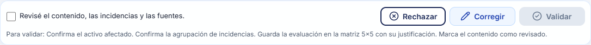

| Elemento | Qué hace |
| --- | --- |
| Casilla **Revisé el contenido, las incidencias y las fuentes** | Obligatoria para validar. |
| Botón **Validar** | Abre la ventana **Validar propuesta**. Se desactiva mientras falte algún requisito; debajo se indica cuál. |
| Botón **Corregir** | Abre la ventana **Corregir propuesta** para editar el contenido. |
| Botón **Rechazar** | Abre la ventana **Rechazar propuesta**. No exige evaluación ni activo confirmado. |

Campos de las ventanas de decisión:

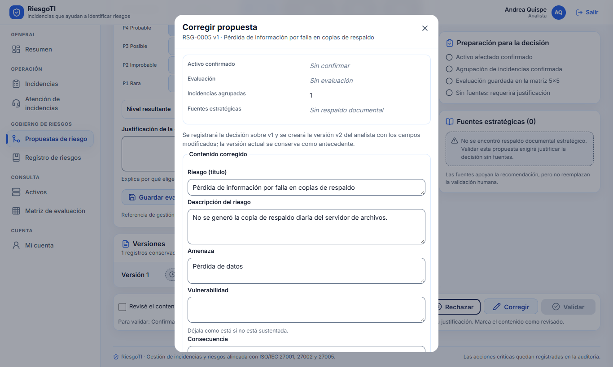

| Ventana | Campos | Botón final | Resultado |
| --- | --- | --- | --- |
| Validar propuesta | **Observación** (mínimo 10 caracteres). Si no hay fuentes: **Justificación de validación sin fuentes documentales** (mínimo 15). | **Registrar validación** | La versión queda **Validada** y pasa a ser la vigente del riesgo. No ejecuta controles ni cierra incidencias. |
| Corregir propuesta | Riesgo (título), Descripción, Amenaza, Vulnerabilidad, Consecuencia y Recomendación (cambia al menos uno) y **Observación**. | **Guardar corrección** | Se crea una versión nueva (v+1) a tu nombre y se abre para seguir trabajando. La versión anterior se conserva. |
| Rechazar propuesta | **Motivo del rechazo** (mínimo 10 caracteres). | **Rechazar propuesta** | La versión queda **Rechazada** y se conserva en el historial. |

En todas las ventanas, **Cancelar** cierra sin registrar nada. Toda decisión queda registrada con tu nombre y fecha y no se puede deshacer.

**Historial de versiones**

| Elemento | Qué hace |
| --- | --- |
| Fila **Versión n** | Despliega el contenido de esa versión, su activo, su evaluación y su decisión. |
| Botón **Comparar con versión anterior** | Muestra lado a lado qué campos cambiaron. **Ocultar comparación** la cierra. |
| Botón **Revisar propuesta vn** | Abre otra versión pendiente del mismo riesgo. |

### 3.6 Registro de riesgos

Una fila por riesgo, con su versión validada vigente.

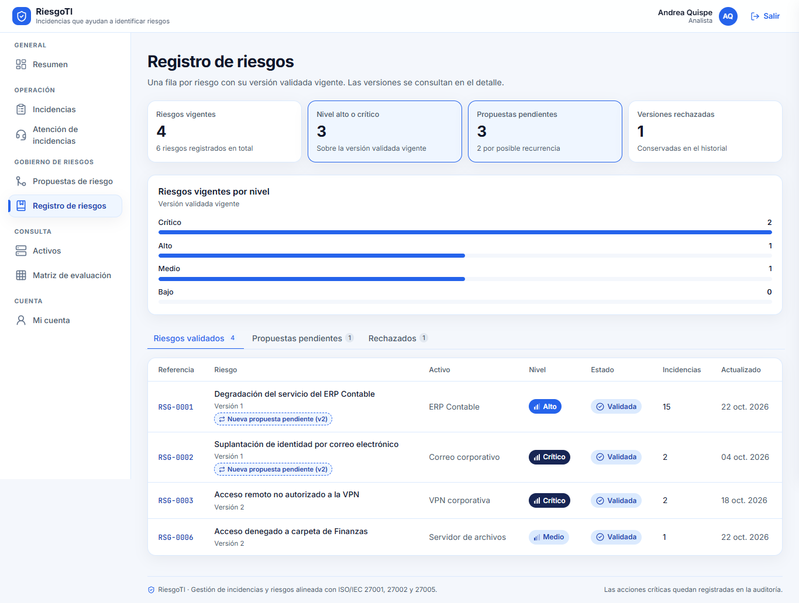

| Elemento | Qué hace |
| --- | --- |
| Indicadores | Riesgos vigentes, de nivel alto o crítico, propuestas pendientes (y cuántas por recurrencia) y versiones rechazadas. |
| Gráfico **Riesgos vigentes por nivel** | Reparte los riesgos validados por nivel. |
| Pestañas **Riesgos validados / Propuestas pendientes / Rechazados** | Cambian la categoría de la tabla. |
| Referencia del riesgo (por ejemplo, **RSG-0002**) | Abre el detalle del riesgo (ver 3.7). |
| Etiqueta **Nueva propuesta pendiente (vn)** | Un riesgo validado tiene una nueva versión esperando decisión. |

### 3.7 Detalle del riesgo

Muestra la versión vigente del riesgo: activo confirmado, nivel, probabilidad × impacto, justificación, contenido, incidencias, decisión y fuentes. Aquí todo es de consulta.

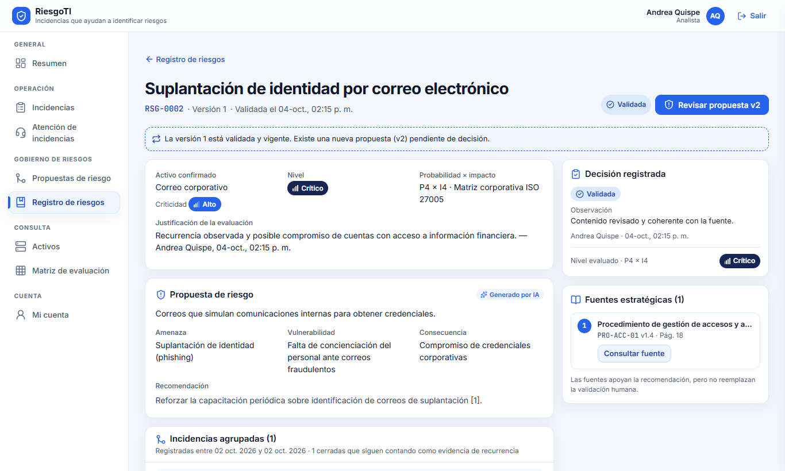

| Elemento | Qué hace |
| --- | --- |
| Enlace **← Registro de riesgos** | Vuelve al registro. |
| Botón **Revisar propuesta vn** | Aparece si hay una versión pendiente. Abre su espacio de trabajo. |
| Botón **Excluidas de la agrupación** | Muestra las incidencias retiradas y sus motivos. |
| Historial de **Versiones** y **Consultar fuente** | Funcionan igual que en el espacio de trabajo. |

### 3.8 Activos y Matriz de evaluación (consulta)

Ambas pantallas son de solo lectura para el Analista; solo un Administrador puede modificarlas.

- **Activos**: lista el catálogo con su tipo, criticidad y estado.
- **Matriz de evaluación**: muestra la configuración vigente, quién la publicó y cuándo. Las pestañas **Matriz 5×5**, **Probabilidad** e **Impacto** muestran los niveles por celda y la descripción de cada criterio.

## 4. Estados, mensajes y errores frecuentes

Toda versión de riesgo empieza **Pendiente** y termina con una de tres decisiones. Ninguna borra versiones anteriores.

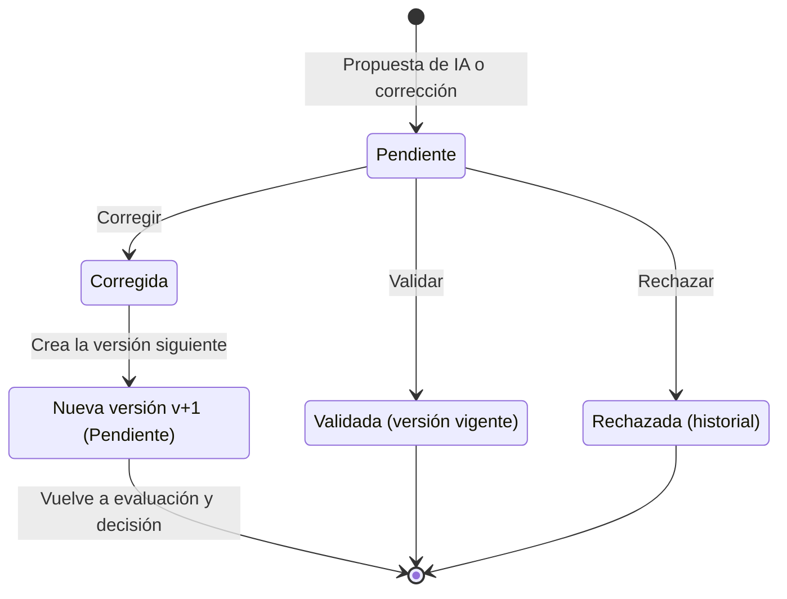

Corregir no cierra el trabajo: crea la versión siguiente, que vuelve a pasar por evaluación y decisión.

Estados de las incidencias:

| Estado | Qué significa | Qué puedes hacer |
| --- | --- | --- |
| Registrada / En análisis | La IA está preparando o ya entregó la orientación. | Consultar el caso. |
| Pendiente de atención | Espera a un analista. | **Iniciar atención**. |
| En atención | Un analista lo tiene asignado. | Si es tuyo: **Guardar nota** o **Cerrar incidencia**. |
| Cerrada | Resuelta por la orientación o por un analista. | Consultar acciones y nota de resolución. |

Mensajes frecuentes:

| Mensaje | Causa | Qué hacer |
| --- | --- | --- |
| «Para cerrar el caso debe detallar las acciones realizadas (mínimo 10 caracteres)» | Intentaste cerrar sin acciones. | Completa **Acciones realizadas**. |
| «Para cerrar el caso debe registrar la nota de resolución (mínimo 10 caracteres)» | Intentaste cerrar sin nota. | Completa **Nota de resolución**. |
| «Explique el motivo por el cual retira este falso positivo (mínimo 10 caracteres)» | Motivo de retiro vacío o corto. | Amplía el motivo. |
| «El activo elegido difiere del reportado en las incidencias: justifique el cambio» | Elegiste otro activo. | Completa la justificación del cambio. |
| «Seleccione un nivel de probabilidad (1 a 5)» o de impacto | Falta un eje de la evaluación. | Elige el criterio o pulsa una celda. |
| «La justificación de evaluación en matriz debe tener al menos 15 caracteres» | Justificación corta. | Amplía la justificación y guarda la evaluación. |
| «Al no existir fuentes documentales estratégicas citadas, debe justificar la validación sin fuentes» | La propuesta no cita fuentes. | Escribe la justificación sin fuentes (mínimo 15 caracteres). |
| «Modifique al menos un campo del contenido para crear la nueva versión» | Abriste Corregir sin cambiar nada. | Edita al menos un campo. |
| «Solo el analista asignado puede registrar la atención» | Otro analista tiene el caso. | Coordina con esa persona. |
| Aviso **Modo lectura** | Tu rol no puede revisar ni decidir riesgos. | Pide la acción a un Analista. |

## 5. Preguntas frecuentes y buenas prácticas

**Si cierro una incidencia, ¿se cierra también su riesgo?** No. La atención operativa y el análisis de riesgo son independientes. El riesgo solo cambia con una decisión en su espacio de trabajo.

**¿Mis notas de resolución enseñan a la IA?** No automáticamente. Quedan como historial. Si una solución debe pasar a los manuales, propón al Administrador una nueva versión del documento para que la cargue y la autorice.

**¿Puedo deshacer una validación o un rechazo?** No. Las decisiones son inmutables. Si el riesgo cambia, la IA o una corrección crean una nueva versión, y la anterior se conserva.

**Una incidencia no tiene relación con el riesgo, ¿la borro?** No se borra: retírala de la agrupación con un motivo claro. Si te equivocas, usa **Restaurar**.

**El análisis de riesgo de un caso falló, ¿se perdió la incidencia?** No. La incidencia se conserva. Usa **Reintentar análisis** en el detalle del caso.

**¿Por qué el botón Validar está desactivado?** Falta algún requisito. Debajo de los botones se lista lo que falta, por ejemplo marcar la casilla de revisión o guardar la evaluación.

Buenas prácticas:

- Atiende la cola desde los casos más antiguos; las escaladas por seguridad son prioritarias.
- Lee el historial de orientación previa antes de actuar, para no repetir pasos que el reportante ya probó.
- Guarda la nota de avance con frecuencia en casos largos.
- Escribe la nota de resolución en lenguaje claro: el reportante la leerá.
- Revisa las incidencias con similitud baja antes de confirmar una agrupación.
- Justifica la evaluación con hechos: número de incidencias, criticidad del activo y fuentes citadas.
- Consulta las fuentes estratégicas antes de validar; si no hay fuentes, explica por qué validas igualmente.
