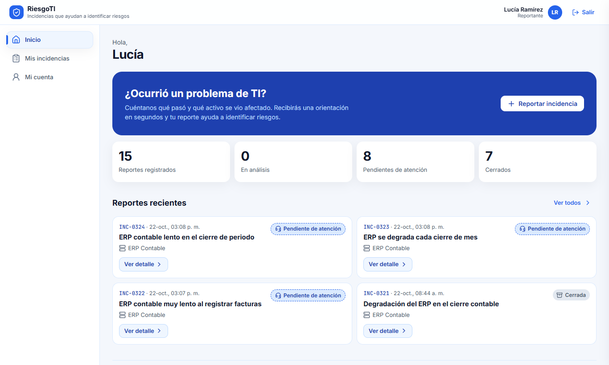
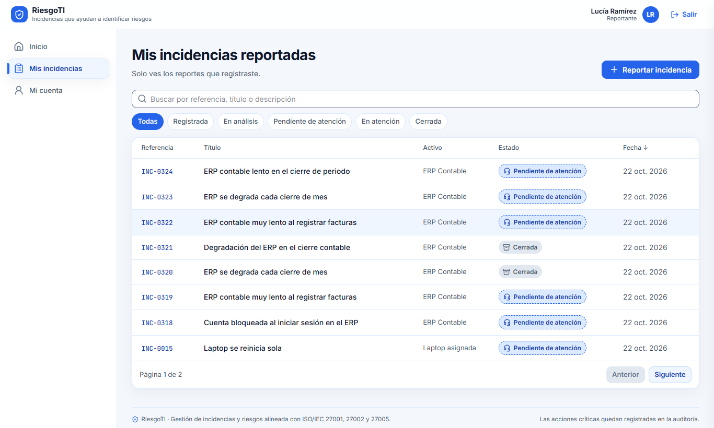
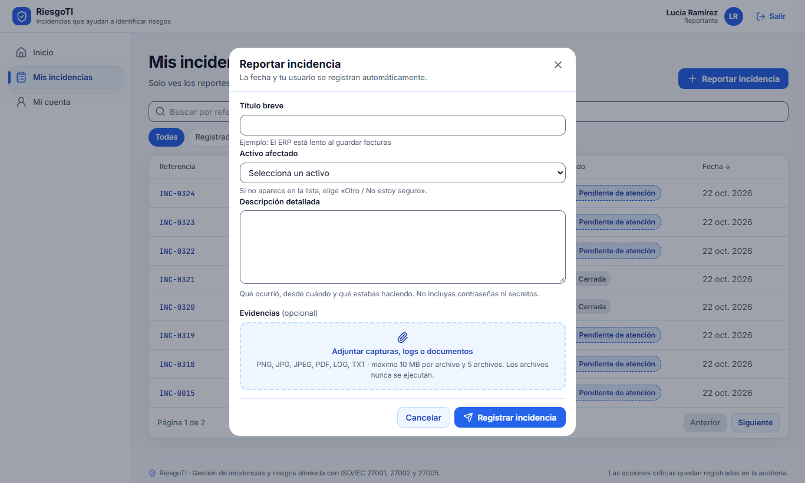
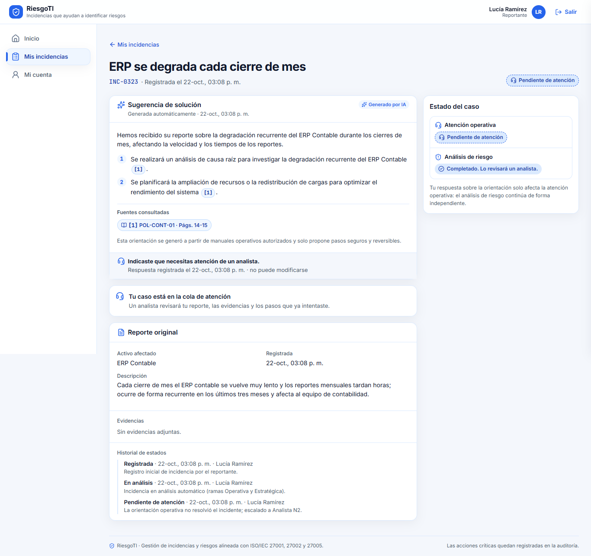
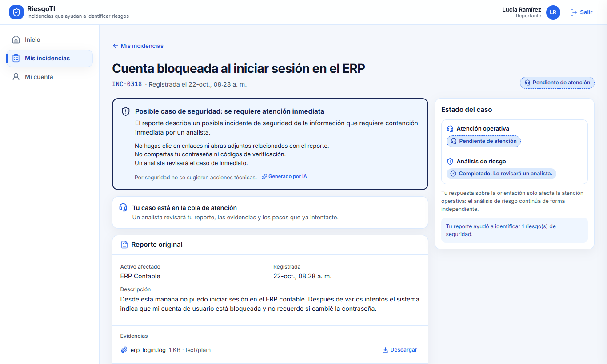
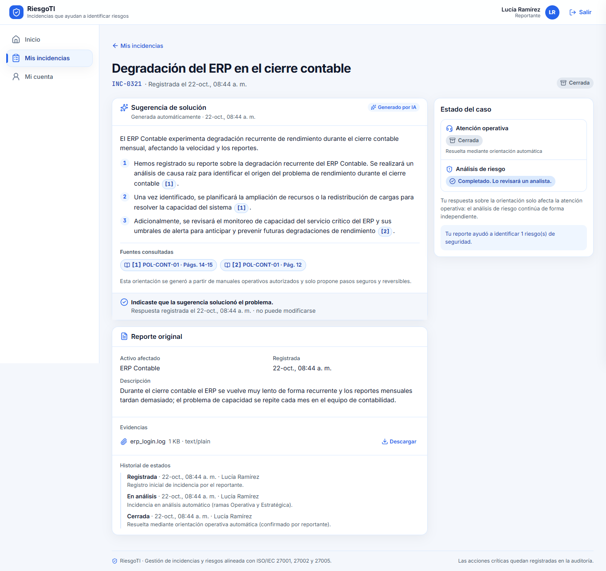
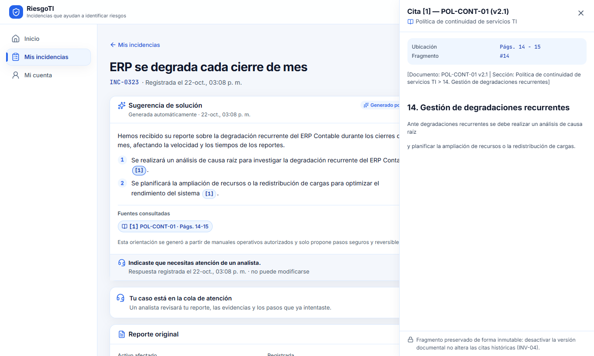
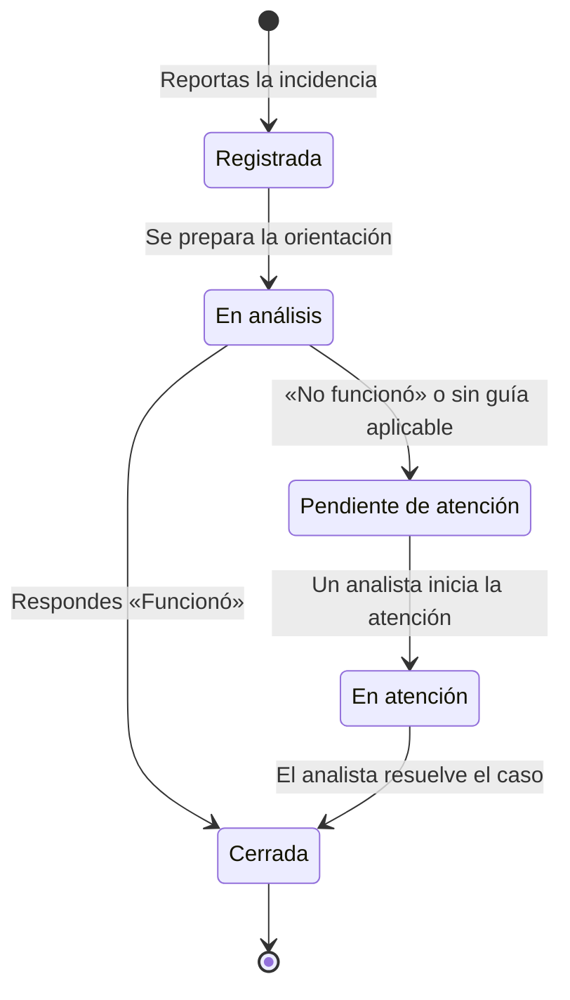

# Manual de usuario RiesgoTI — Reportante

Oct 22, 2026

## 1. Introducción e inicio de sesión

Como Reportante, usas RiesgoTI para avisar de un problema de TI y recibir en segundos una orientación con pasos sugeridos. Solo ves las incidencias que tú registraste. Cada reporte también alimenta, en segundo plano, el análisis de riesgos de seguridad que hace el equipo de Analistas.

### Pantalla: Iniciar sesión

| Elemento | Qué hace |
| --- | --- |
| Campo **Correo institucional** | Escribe tu correo de la empresa (por ejemplo, nombre.apellido@empresa.pe). |
| Campo **Contraseña** | Escribe tu contraseña. |
| Icono del ojo (**Mostrar / Ocultar contraseña**) | Muestra u oculta los caracteres de la contraseña para comprobar que la escribiste bien. |
| Botón **Ingresar** | Valida tus datos y abre tu portal. Mientras procesa, dice «Ingresando…». |

Si el correo o la contraseña no son correctos, o tu usuario está desactivado, aparece un mensaje de error sobre el formulario. Tras varios intentos fallidos seguidos, el sistema bloquea temporalmente el acceso durante un minuto. Si olvidaste tu contraseña, pide a un Administrador que la restablezca.

## 2. Navegación general

Todas las pantallas comparten la misma estructura: una cabecera arriba, un menú a la izquierda y el contenido al centro.

| Elemento | Dónde está | Qué hace |
| --- | --- | --- |
| Menú **Inicio** | Menú lateral | Abre tu pantalla de inicio con el resumen y los reportes recientes. |
| Menú **Mis incidencias** | Menú lateral | Abre el listado completo de tus reportes. |
| Menú **Mi cuenta** | Menú lateral | Muestra tus datos, tu rol y tus permisos. |
| Botón de menú (tres líneas) | Cabecera, solo en celular | Abre el menú lateral como panel desplegable. |
| Tu nombre y rol | Cabecera, a la derecha | Indica con qué usuario iniciaste sesión. |
| Botón **Salir** | Cabecera, a la derecha | Cierra tu sesión y vuelve a la pantalla de inicio de sesión. |

La opción del menú en la que estás aparece resaltada. Si usas el teclado, la primera tecla Tab muestra el enlace **Saltar al contenido**, que lleva directo al contenido de la pantalla.

### Pantalla: Mi cuenta

Esta pantalla es solo de consulta: no tiene botones. Muestra tu nombre, tu correo institucional, tu rol y cuántos permisos tienes. Al lado aparece la lista **Permisos por módulo**, con una marca junto a cada permiso que tienes. Si algún dato está mal, pídele a un Administrador que lo corrija.

## 3. Pantallas del Reportante

### 3.1 Inicio

Es la primera pantalla que ves al entrar. Te saluda por tu nombre y resume el estado de tus reportes.

| Elemento | Qué hace |
| --- | --- |
| Botón **Reportar incidencia** (recuadro «¿Ocurrió un problema de TI?») | Abre el formulario para registrar una nueva incidencia (ver 3.3). |
| Indicadores | Muestran cuántos reportes tienes registrados, en análisis, pendientes de atención y cerrados. Son solo informativos. |
| Tarjetas de **Reportes recientes** | Muestran tus 4 reportes más recientes con su referencia (por ejemplo, INC-0012), fecha, título, activo afectado y estado. |
| Botón **Ver detalle** (en cada tarjeta) | Abre el detalle de esa incidencia (ver 3.4). |
| Botón **Ver todos** | Lleva a Mis incidencias con el listado completo. |

Si todavía no tienes reportes, verás el mensaje «Aún no tienes reportes».

### 3.2 Mis incidencias reportadas

Muestra todas tus incidencias en una tabla, de la más reciente a la más antigua, con 8 filas por página.

| Elemento | Qué hace |
| --- | --- |
| Botón **Reportar incidencia** (arriba a la derecha) | Abre el formulario de registro (ver 3.3). |
| Buscador | Filtra mientras escribes por referencia, título o descripción. |
| Filtros de estado (**Todas**, **Registrada**, **En análisis**, **Pendiente de atención**, **En atención**, **Cerrada**) | Muestra solo las incidencias del estado elegido. **Todas** quita el filtro. |
| Encabezado **Fecha ↓ / ↑** | Cambia el orden entre más recientes primero y más antiguas primero. |
| Referencia de la fila (por ejemplo, **INC-0012**) | Abre el detalle de esa incidencia. |
| Paginador | Pasa a la página siguiente o anterior del listado. |
| Botón **Limpiar filtros** | Aparece cuando la búsqueda no da resultados. Borra el texto y vuelve a **Todas**. |

### 3.3 Formulario: Reportar incidencia

Se abre en una ventana sobre la pantalla actual. La fecha y tu usuario se guardan automáticamente.

| Campo o botón | Qué hace | Regla |
| --- | --- | --- |
| **Título breve** | Resume el problema en una frase, por ejemplo «El ERP está lento al guardar facturas». | Obligatorio, entre 5 y 255 caracteres. |
| **Activo afectado** | Lista de equipos, aplicaciones y servicios de la empresa. Elige el que falló. | Obligatorio elegir uno o usar «Otro». |
| Opción **Otro / No estoy seguro** | Muestra el campo «¿Qué recurso se vio afectado?» para describirlo con tus palabras. | Al menos 2 caracteres. |
| **Descripción detallada** | Explica qué ocurrió, desde cuándo y qué estabas haciendo. | Obligatoria, mínimo 20 caracteres. Nunca escribas contraseñas ni secretos. |
| Zona **Adjuntar capturas, logs o documentos** | Haz clic para elegir archivos o arrástralos sobre la zona. | Opcional. PNG, JPG, JPEG, PDF, LOG o TXT; hasta 5 archivos de 10 MB cada uno. |
| Botón **X** junto a un archivo | Quita ese archivo antes de enviar. | — |
| Botón **Cancelar** | Cierra la ventana sin guardar nada. | — |
| Botón **Registrar incidencia** | Valida y envía el reporte. Mientras procesa, dice «Registrando…». | Si falta algo, el mensaje aparece debajo del campo. |

Al registrar, el sistema te lleva directamente al detalle de la nueva incidencia para que veas la orientación.

### 3.4 Detalle de la incidencia

Muestra el título, la referencia, la fecha de registro y el estado actual de tu caso. Se actualiza solo cada pocos segundos mientras la orientación se prepara: no hace falta recargar la página.

| Elemento | Qué hace |
| --- | --- |
| Enlace **← Mis incidencias** | Vuelve al listado. |
| Tarjeta **Preparando una orientación para tu caso** | Indica el avance: reporte registrado, consulta de manuales y preparación de la orientación. Puedes salir de la página; el resultado quedará guardado. |
| Tarjeta **Sugerencia de solución** | Muestra un resumen y los pasos numerados que puedes seguir. Fue generada por IA a partir de manuales autorizados de la empresa. |
| Marcas de cita **\[1\]**, **\[2\]** en el texto | Abren el panel de la fuente (ver 3.5) con el fragmento del manual que respalda ese paso. |
| Chips de **Fuentes consultadas** | Hacen lo mismo que las marcas de cita y muestran el documento y las páginas. |
| Botón **Sí, funcionó (cerrar incidencia)** | Confirma que los pasos resolvieron el problema. La incidencia pasa a **Cerrada**. |
| Botón **No funcionó, escalar a un analista** | Indica que el problema sigue. El caso pasa a **Pendiente de atención** y lo atenderá una persona de Soporte TI. |
| Tarjeta **Reporte original** | Muestra el activo, la fecha, la descripción y las evidencias que enviaste. |
| Botón **Descargar** (junto a cada evidencia) | Descarga el archivo que adjuntaste. |
| **Historial de estados** | Lista cada cambio de estado con su fecha y la persona o proceso que lo hizo. |
| Panel **Estado del caso** (a la derecha) | Muestra dos líneas separadas: **Atención operativa** (tu problema) y **Análisis de riesgo** (la evaluación de seguridad que sigue en segundo plano). |

Tu respuesta sobre la sugerencia se registra una sola vez y **no puede modificarse**. Los dos botones solo aparecen cuando hay una sugerencia y aún no respondiste.

Otras tarjetas que pueden aparecer en lugar de la sugerencia:

- **Tu caso fue derivado a un analista de soporte**: no se encontró una guía aplicable en los manuales vigentes o el servicio de IA no respondió. No tienes que hacer nada: un analista revisará tu reporte.
- **Posible caso de seguridad: se requiere atención inmediata** (recuadro rojo): tu reporte parece un incidente de seguridad, por ejemplo si mencionaste una contraseña. Por seguridad no se sugieren pasos técnicos y el caso pasa directo a un analista.
- **Tu caso está en la cola de atención** o **\[Nombre\] está atendiendo tu caso**: indica quién lleva tu caso.
- **Resolución de la atención**: cuando el analista cierra el caso, aquí ves su nota de resolución, su nombre y la fecha.

Ejemplo de un caso marcado como posible caso de seguridad:

Ejemplo de un caso cerrado tras confirmar que la sugerencia funcionó:

### 3.5 Panel de cita normativa

Se abre por el lado derecho al pulsar una cita. Muestra el código y la versión del documento, su título, las páginas, el número de fragmento y el texto exacto citado. Si la versión del documento ya no está vigente, lo indica como «Desactivada (consulta histórica)»; la cita se conserva igual.

| Elemento | Qué hace |
| --- | --- |
| Botón **X** (arriba a la derecha) | Cierra el panel. |
| Tecla **Esc** | También cierra el panel. |

## 4. Estados, mensajes y errores frecuentes

Una incidencia termina **Cerrada** por uno de dos caminos: confirmas que la sugerencia funcionó o un analista resuelve el caso.

Si respondes «No funcionó», o el sistema no encuentra una guía aplicable, el caso pasa a la cola de Soporte TI sin que tengas que hacer nada más.

| Estado | Qué significa para ti |
| --- | --- |
| Registrada | El reporte se guardó. La orientación se está preparando. |
| En análisis | La orientación está lista o en curso. Revisa la sugerencia y responde si funcionó. |
| Pendiente de atención | El caso espera a que un analista lo tome. |
| En atención | Un analista está trabajando en tu caso. |
| Cerrada | El caso terminó. Si lo cerró un analista, verás su nota de resolución. |

Mensajes frecuentes:

| Mensaje | Causa | Qué hacer |
| --- | --- | --- |
| «El título debe describir brevemente el problema (mínimo 5 caracteres)» | Título demasiado corto. | Escribe un título más descriptivo. |
| «Describa qué ocurrió con al menos 20 caracteres» | Descripción demasiado corta. | Amplía la descripción. |
| «Seleccione un activo del catálogo o especifique el recurso afectado en texto libre» | No elegiste activo. | Elige uno de la lista o usa «Otro / No estoy seguro». |
| «Formatos permitidos: png, jpg, pdf, log, txt» | Adjuntaste un tipo de archivo no aceptado. | Quítalo con la X y conviértelo a un formato permitido. |
| «Cada evidencia debe pesar como máximo 10 MB» | Un archivo es demasiado grande. | Recorta la captura o comprime el archivo. |
| «Máximo 5 evidencias por incidencia» | Adjuntaste más de 5 archivos. | Quita los menos importantes. |
| «Incidencia no disponible» | La incidencia no existe o la registró otra persona. | Vuelve a Mis incidencias y abre una de tus incidencias. |
| Error al cargar con botón para reintentar | Falló la conexión con el servidor. | Pulsa el botón de reintento; si persiste, avisa a Soporte TI. |

## 5. Preguntas frecuentes y buenas prácticas

**¿Puedo cambiar mi respuesta «Sí, funcionó» o «No funcionó»?** No. La respuesta queda registrada como evidencia. Si el problema vuelve después de cerrar el caso, registra una incidencia nueva.

**¿Puedo editar o borrar un reporte?** No. Si te equivocaste, registra uno nuevo y aclara en la descripción que corrige al anterior (por ejemplo, «corrige INC-0012»).

**Cerré mi caso con «Sí, funcionó», ¿se pierde el análisis de riesgo?** No. El análisis de riesgo sigue en segundo plano aunque tu incidencia esté cerrada. Si tu reporte ayuda a identificar un riesgo, el panel Estado del caso lo indica.

**¿Por qué no veo las incidencias de mis compañeros?** Por confidencialidad, cada Reportante solo ve sus propios reportes.

Buenas prácticas:

- Escribe un título concreto: qué falla y dónde.
- En la descripción indica desde cuándo ocurre, qué estabas haciendo y el mensaje de error exacto.
- Adjunta capturas de pantalla o logs: ayudan al analista si el caso escala.
- Nunca escribas contraseñas, códigos de acceso ni datos personales de terceros.
- Sigue los pasos sugeridos en orden antes de responder si funcionaron.
- Cierra sesión con **Salir** al terminar, sobre todo en equipos compartidos.
